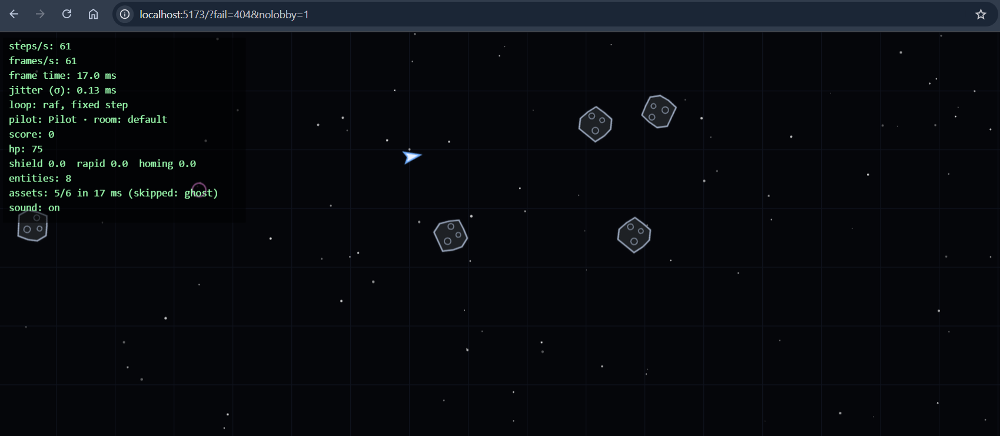
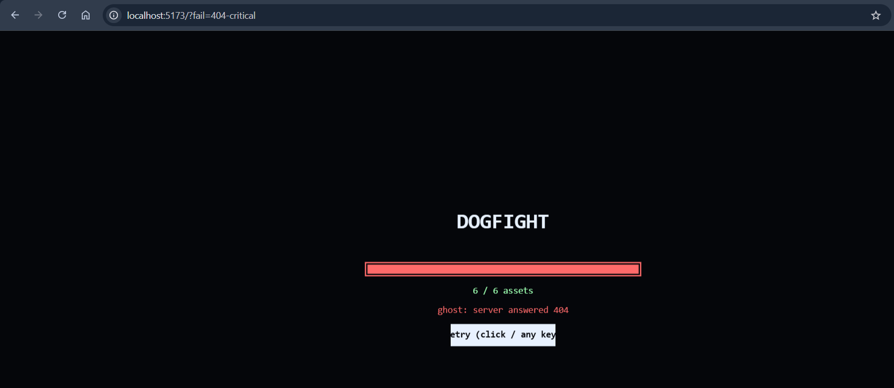
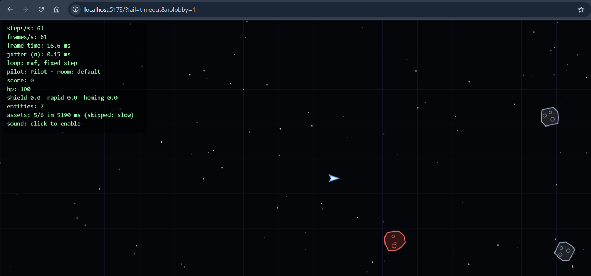
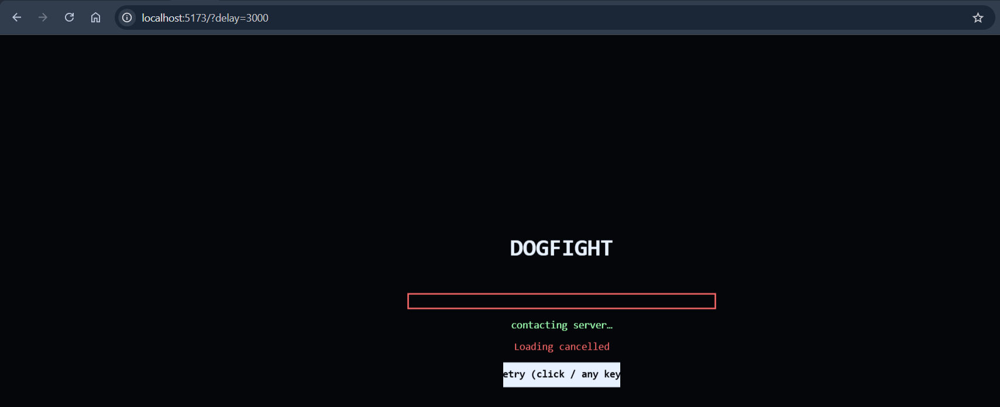
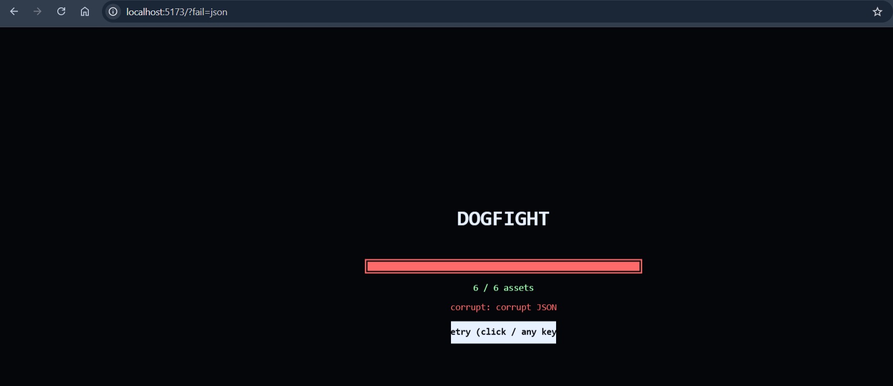
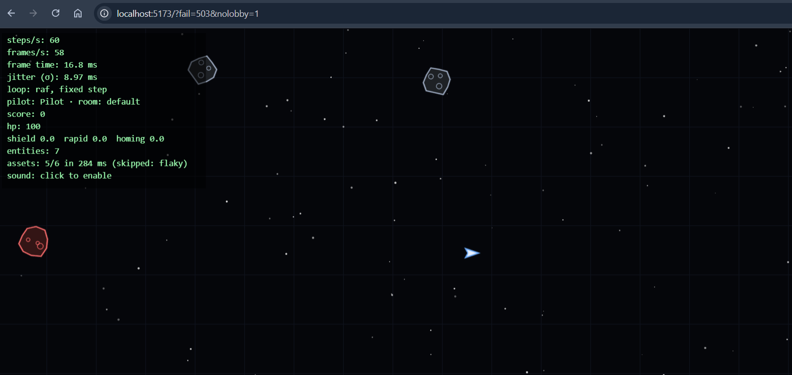

# Dogfight — Lab 03: Asynchronous JavaScript

A ship you fly and shoot on a canvas, driven by a fixed-timestep simulation (60 steps/s) and rendered
with interpolation. Lab 01 (loop, input, experiments) and Lab 02 (entity model) are unchanged; Lab 03 adds an
asset pipeline with a loading screen, sprites and sound, and an HTTP lobby.

## Run

```bash
npm install
npm run dev      # open the printed URL (http://localhost:5173)
npm run lint
npm run build
```

Flow: **loading screen → lobby → game**. Controls: `←` / `→` (or `A` / `D`) rotate, `↑` (or `W`) thrust, `Space` or mouse click to fire.
Pickups: **S** shield, **R** rapid fire, **H** homing bullets. Red asteroids are homing hunters.

`npm run smoke` runs headless checks of the sim, the loader (retry, abort, progress), the event
decoupling and the lobby; `?bug=1` demonstrates the `this` bug below. Sound starts after the first click or key.

## Structure

```txt
src/main.js           wires everything, experiment switches via URL
src/loop.js           createLoop({ step, simulate, render }) — rAF + clamped accumulator
src/input.js          createInput() — closure over key state (isDown, justPressed)
src/sim/vector.js     Vector2 (pure methods, *InPlace variants)
src/sim/entity.js     Entity base (private static #id counter, behaviors list)
src/sim/ship.js       Ship extends Entity (#hp, fire, pickups); integrate() kept for the lab-01 script
src/sim/bullet.js     Bullet (TTL) · asteroid.js · pickup.js · explosion.js — each extends Entity
src/sim/behaviors.js  homing() — composed behavior, attachable to any entity
src/sim/world.js      World: Map store, iterable, *ofKind, deferred sweep, collision rules, respawn,
                      `events` (EventTarget): fired / hit / exploded / scoreChanged
src/sim/collision.js  findCollisions(world) -> (a, b) pairs, naive O(n^2), swappable
src/sim/arena.js      wrap / bounce
src/render/canvas.js  DPR-aware, resizable canvas
src/render/draw.js    lerp/lerpAngle, background, drawWorld (all kinds), HUD
src/assets/loader.js  fetchJson/loadImage/loadAudio/loadJson, withRetry, loadManifest, loadAll
src/assets/failures.js  ?fail=... injects one broken asset (failure gallery)
src/audio.js          AudioContext owner, unlocked by a gesture; subscribes to world events
src/hud.js            score popups; subscribes to world events
src/events.js         once(target, type) — event -> promise
src/lobby/lobby.js    class Lobby extends EventTarget (refresh interval, timeout, abort-on-leave)
src/lobby/lobbyView.js  DOM rendering of the lobby, driven by its events
src/render/loading.js loading screen; src/render/sprites.js sprite sheet
public/assets/        manifest.json, arena.json, sprites.png, sfx/*.wav (scripts/make-assets.py regenerates them)
public/api/rooms.json static room list (Lab 04 replaces it with a server)
vite.config.js        dev/preview middleware: ?delay=MS, /__test/503, /__test/corrupt.json, real 404s
scripts/smoke.mjs     headless checks for Lab 02
scripts/smoke-assets.mjs  headless checks for Lab 03
scripts/determinism.mjs   offline illustration of experiment 3
```

## Ship tuning

| Constant    | Value | Why                                                      |
| ----------- | ----- | -------------------------------------------------------- |
| `TURN_RATE` | 3.5   | ~0.6 turn/s: responsive without being twitchy            |
| `ACCEL`     | 320   | reaches useful speed in ~1.5 s                           |
| `DRAG`      | 0.7   | ship slowly glides to a stop instead of drifting forever |
| `MAX_SPEED` | 420   | stops the ship from crossing the arena in under 3 s      |

## Design notes

- **Loop**: `requestAnimationFrame` + accumulator; frame delta is clamped to 0.25 s so a long hitch
  never causes a spiral of death. `render` receives `alpha = accumulator / step`.
- **Interpolation**: `previous` and `current` ship states are copied each step; the renderer draws at
  `lerp(previous, current, alpha)`, angle via shortest-arc `lerpAngle`. When the ship wraps around the
  arena, interpolation on that axis is skipped to avoid a streak across the screen.
- **Input**: closure over two private `Set`s; `justPressed` stays true until `endStep()` (called after
  every simulation step).
- **Sim** has no DOM/canvas dependency and is a pure function of state + input + dt.

## Lab 02 notes

### The `this` bug

`canvas.addEventListener("click", ship.fire)` passes the function, not the call. The browser calls the
listener with `this` = the canvas, so `fire` no longer sees the ship (`?bug=1` reproduces it; `fire()`
throws a `TypeError` on purpose). Fixes:

| Fix                                  | Downside                                                          |
| ------------------------------------ | ----------------------------------------------------------------- |
| `() => world.player.fire()` (chosen) | none here; also picks up the _new_ ship after a respawn           |
| `ship.fire.bind(ship)`               | permanently bound to the old ship; a new bound copy per call site |
| `fire = () => {…}` class field       | one arrow function per instance (memory), not on the prototype    |

### Design: composition instead of a deep hierarchy

Inheritance is one level: `Ship`, `Bullet`, `Asteroid`, `Pickup`, `Explosion` all `extends Entity`.
Anything extra is a **behavior object** in `entity.behaviors` (`{ update(entity, dt, world) }`), run by
`Entity.update` before the entity moves.

- **Homing**: `homing({ seek, turnRate })` is attached to a player bullet (seeks asteroids, from the
  homing pickup) and to some asteroids (seek the ship). With inheritance this needs
  `Entity → Moving → Homing → HomingBullet` _and_ `HomingAsteroid`, duplicating `Homing` under
  `Bullet` and `Asteroid`, or a `HomingMixin` hack; with composition it is one function and
  `push`.
- **Pickup**: stationary and collidable but not a ship, so it must not inherit `Ship` or `Moving`.
  It is a plain `Entity` carrying an `effect` string; durations live in a data table (`EFFECTS`) and
  the ship maps effect → timer. A new pickup is one table row, not a new class.
- **Kept as classes**: `Ship`, `Bullet` etc. stay as one-level subclasses because they have real
  state (`#hp`, TTL, cooldown). Behaviors cover what varies _across_ kinds.

Trade-off: behaviors are looked up per entity at runtime (a loop over a short array), slightly slower
than a method call, and ordering between behaviors matters. Fine at this scale; revisit in Lab 7.

## Lab 03 notes

### Asset pipeline (M1)

`public/assets/manifest.json` lists `{ key, type, url, critical? }` plus the sprite-sheet `frames`.
`loadManifest` → `loadAll(manifest, { onProgress, signal })`:

- `loadImage` / `loadAudio` / `loadJson` all go through `fetchOk`, which turns `!res.ok` into an `HttpError`
  (a 404 is a _fulfilled_ `fetch`). Images are fetched first and decoded from a blob, so a missing sprite is
  an `HttpError 404`, not an anonymous `onerror`. `new Promise` is used only to wrap `img.onload/onerror`.
- `withRetry(fn, { attempts, baseMs, signal })`: delay before retry _n_ is `random() * baseMs * 2^(n-1)`
  (full jitter). Retried: network `TypeError`, per-attempt `TimeoutError`, HTTP 5xx. Never retried: 4xx,
  `JsonError`, `DecodeError`, abort.
- `loadAll` is `Promise.all` over items; each item is `.then`-wrapped so the progress bar ticks when _it_
  settles. Every attempt has its own `AbortSignal.timeout`. An optional item that fails (a sound) goes to
  `failures` and the game still starts; a `critical` one rejects `loadAll`, which first aborts the siblings
  (`Promise.all` alone would let them keep running).
- Loading screen: real bar (`done / total`), a spinner driven by the clock (the loop is not blocked), `Esc`
  aborts, errors show a Retry button (click / any key).
- Sounds are fetched and `decodeAudioData`-ed here, on the loading screen; the `AudioContext` only starts
  after the first click/key (`audio.js`).

Timing (`?seq=1` loads one item after another; `?delay=300` delays every `/assets` request by 300 ms in the
dev server; the console prints `[assets] N items in X ms`):

| Mode                       | 5 assets, `?delay=300` |
| -------------------------- | ---------------------- |
| concurrent (`Promise.all`) | 339 ms                 |
| sequential (`?seq=1`)      | 1588 ms                |

Expected: ≈ 300 ms vs ≈ 1500 ms (the test in `smoke-assets.mjs` checks the same with fake loaders).

### Sprites, sound, decoupling (M2)

Ships, bullets, asteroids and pickups are drawn from `sprites.png` with `drawImage(img, sx, sy, sw, sh, …)`;
if a frame or the sheet is missing, `draw.js` falls back to the old vector drawing. `src/sim/*` imports
neither `audio.js`, `hud.js` nor anything from `render/`, `lobby/`, `assets/` — `smoke-assets.mjs` greps for it.
The `World` owns an `EventTarget` (`world.events`) and dispatches `fired`, `hit`, `exploded`, `scoreChanged`;
`audio.attach(world.events)` plays sounds and `hud.attach(world.events)` shows `+100` popups.

### Lobby over HTTP (M3)

`class Lobby extends EventTarget` fetches `/api/rooms.json` (events `roomsChanged`, `failed`, `joined`).
`enter()` refreshes on an interval; every request has `AbortSignal.timeout(4000)` combined with the lobby's
own `AbortController` (`AbortSignal.any`); `leave()` / `join()` abort it, so a late response never touches a
screen that is gone (`smoke-assets.mjs` checks this). `lobbyView.js` only renders what the events say.
"Join" starts a local game with the room's arena config (asteroid count, pickups, background, stars).

### Ordering puzzles (M4a)

Outputs were checked in Node 22 (puzzle 5 needs a browser).

1. `setTimeout` inside a `.then`

   ```js
   setTimeout(() => console.log("T"), 0);
   Promise.resolve()
     .then(() => {
       console.log("M1");
       setTimeout(() => console.log("T-in-then"), 0);
     })
     .then(() => console.log("M2"));
   console.log("S");
   // S, M1, M2, T, T-in-then
   ```

   Sync first, then the whole microtask queue (`M1`, then `M2` which `M1` queued), then timers in the order
   they were scheduled: `T` before the timer created inside `M1`.

2. `await` splits a function

   ```js
   async function f() {
     console.log("f1");
     await Promise.resolve();
     console.log("f2");
     await new Promise((r) => setTimeout(r, 0));
     console.log("f3");
   }
   f();
   Promise.resolve().then(() => console.log("p"));
   console.log("sync");
   setTimeout(() => console.log("timer"), 0);
   // f1, sync, f2, p, timer, f3
   ```

   `f1` runs synchronously up to the first `await`; `f2` was queued before `p`; `f3` waits for a timer that
   was scheduled _after_ `timer`.

3. Returning a promise from `.then` costs extra microtask turns

   ```js
   Promise.resolve()
     .then(() => Promise.resolve("x"))
     .then(() => console.log("A"));
   Promise.resolve()
     .then(() => console.log("B"))
     .then(() => console.log("C"))
     .then(() => console.log("D"));
   // B, C, D, A
   ```

   Assimilating a returned promise takes extra turns, so the chain that returned one finishes last.

4. `finally` and `catch`

   ```js
   Promise.reject(new Error("e"))
     .finally(() => console.log("fin"))
     .catch(() => console.log("catch"))
     .then(() => console.log("then"));
   console.log("sync");
   // sync, fin, catch, then
   ```

   `finally` runs for a rejection and passes it on; `catch` handles it, so the chain is fulfilled again.

5. `requestAnimationFrame` (check in the browser console)

   ```js
   requestAnimationFrame(() => {
     console.log("raf");
     Promise.resolve().then(() => console.log("micro in raf"));
   });
   Promise.resolve().then(() => console.log("micro"));
   console.log("sync");
   // sync, micro, raf, micro in raf
   ```

   rAF runs just before the next paint, after the current task's microtasks; a microtask queued inside the
   rAF callback runs right after the callback, before the paint. (Order against `setTimeout(0)` is not
   guaranteed, so it is not part of the puzzle.)

### Failure gallery (M4b)

Each case is one URL; the dev server (`npm run dev`) provides the broken endpoints. Add a screenshot or the
console log under each row.

| Case            | URL                         | What must happen                                                    | Evidence |
| --------------- | --------------------------- | ------------------------------------------------------------------- | -------- |
| 404 sprite      | `/?fail=404&nolobby=1`      | `HttpError 404` (no retries), game starts, HUD: `skipped: ghost`    |      |
| 404, critical   | `/?fail=404-critical`       | loading stops: "ghost: server answered 404" + Retry button          |       |
| network timeout | `/?fail=timeout&nolobby=1`  | 1.5 s per attempt × 3 with backoff, then skipped; game starts       |       |
| abort mid-load  | `/?delay=3000`, press `Esc` | "Loading cancelled" + Retry button, no orphaned requests in Network |       |
| corrupt JSON    | `/?fail=json`               | "corrupt: corrupt JSON" + Retry button (not retried automatically)  |       |
| 503 (retry)     | `/?fail=503&nolobby=1`      | 3 requests with growing pauses in Network, then skipped             |       |

What rejects and what does not: a 404/503 is a _fulfilled_ `fetch` turned into `HttpError` by `fetchOk`;
only a missing connection, an abort or a timeout makes `fetch` itself reject; bad JSON fails later, in
`res.json()`, after the headers arrived.

## Experiments (M4 of Lab 01)

HUD shows steps/s, frames/s, frame time and jitter (σ of frame time over the last second).
Switches are URL parameters, so no code edits are needed:

| Experiment | URL                                           |
| ---------- | --------------------------------------------- |
| baseline   | `http://localhost:5173/`                      |
| 1 busy     | `http://localhost:5173/?busy=1`               |
| 2 interval | `http://localhost:5173/?loop=interval`        |
| 3 variable | `http://localhost:5173/?step=variable&auto=1` |
| 3 fixed    | `http://localhost:5173/?auto=1`               |


### Baseline

- Display refresh rate: **≈ 60 Hz**
- steps/s: **61**, frames/s: **61**, frame time: **16.5 ms**, jitter: **0.27 ms**

### Experiment 1 — 100 ms busy-wait in `render` every 60th frame

- Player sees: the ship stutters / freezes for about a tenth of a second once per second.
- HUD: frame time on the affected frame is **___ ms**; fps dips to **56** (baseline 61); jitter
  grows to **11.00 ms** (baseline 0.27 ms); steps/s stays at **61** because the accumulator
  catches up with extra fixed steps after the block.
- Why it cannot be worked around: JavaScript runs to completion on one thread. While the
  busy-wait occupies the call stack, the event loop cannot take anything from the task queue,
  drain microtasks, run rAF callbacks or let the browser paint. Nothing on the same thread
  (timers, promises, other callbacks) can run until the function returns.

### Experiment 2 — `setInterval(frame, 16)` instead of rAF

Measurement (`?loop=interval`) vs baseline:

|               | rAF  | setInterval(16) |
| ------------- | ---- | --------------- |
| frames/s      | 61   | 51              |
| jitter σ (ms) | 0.27 | 45.42           |

Background tab for 5 s and back: ___ (rAF pauses entirely; timers keep running but are throttled
by the browser, and the clamped delta prevents a jump).

Differences: the timer is not aligned with the display refresh (16 ms ≠ 16.67 ms, so frames are
skipped or doubled and motion judders), it drifts, and it keeps firing in background tabs.

### Experiment 3 — variable timestep vs fixed timestep (CPU 6× throttle)

Position after 5 s of simulated time while holding thrust, read from
the HUD or console (`[auto] …`):

| Mode                               | CPU normal | CPU 6× throttle |
| ---------------------------------- | ---------- | --------------- |
| variable (`?step=variable&auto=1`) | x=822.883  | x=822.883       |
| fixed (`?auto=1`)                  | x=809.876  | x=809.876       |

Expected: variable positions differ between runs, fixed positions match.

Offline reproduction with the real sim code (`npm run determinism`, arena 1920×1080, 5 s of thrust,
different frame times):

```txt
VARIABLE timestep:  8.33 ms -> x=672.803   16.67 ms -> x=667.294   50 ms -> x=651.143   100 ms -> x=615.881
FIXED timestep:     all frame times -> x=666.876 (300 steps)
```

# Two windows at 100 ms RTT
<video controls src="Video.mp4" title="Title"></video>
