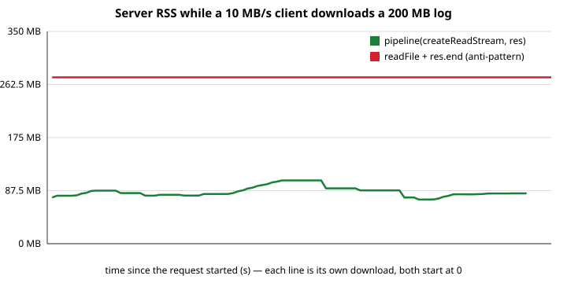

# Dogfight server (Lab 04)

A `node:http` + [`ws`](https://github.com/websockets/ws) server: serves the built client, a small JSON API, rooms with
WebSocket chat, match logs streamed to disk, and replays streamed back.

```txt
npm install                       # at the repo root (npm workspaces: client + server)
npm run dev                       # server on :3000 and Vite on :5173 (Vite proxies /api, /health, /ws)
npm run build && npm start        # production: Node serves client/dist on http://127.0.0.1:3000
npm test                          # node:test, ~30 tests (HTTP, WebSocket, streams, shutdown, Connection)
```

Configuration is read from the environment in `src/config.js` only (`cp .env.example .env`; Node loads it with
`--env-file-if-exists`). Invalid values stop the server at startup with a message.

## Layout

```txt
src/index.js        entry: config -> app -> listen; SIGINT/SIGTERM -> graceful shutdown
src/app.js          wires RoomManager + http handler + WebSocketServer + match logs; close()
src/config.js       PORT, HOST, LOG_DIR, STATIC_DIR and all limits (validated)
src/http.js         routes: /health, /api/rooms (GET, POST), /api/replays[/:id], static fallback
src/static.js       static files: MIME types, ETag/304, path-traversal guard, pipeline streaming
src/rooms.js        Room extends EventEmitter; RoomManager (create / find / delete on "empty")
src/protocol.js     message types, close codes, validate()
src/ws.js           connection lifecycle: join deadline, validation, rate limit, heartbeat, slow clients
src/ratelimit.js    token bucket
src/log/matchlog.js room events -> object-mode Transform -> NDJSON file (pipeline)
src/log/replay.js   async generator over an NDJSON file; list of replays
scripts/            backpressure-demo.mjs, block-demo.mjs, crash-demo.mjs (experiments below)
test/               node:test suite
```

## HTTP API

| Request                 | Result                                                                                                 |
| ----------------------- | ------------------------------------------------------------------------------------------------------ |
| `GET /health`           | `{ status, uptimeSec, rss, rooms, connections }`                                                       |
| `GET /api/rooms`        | `[{ id, name, players, maxPlayers, arena }]`                                                           |
| `POST /api/rooms`       | body `{ name, maxPlayers?, arena? }` (JSON, capped at `MAX_BODY_BYTES`) → 201, 400/409/413/415/422/503 |
| `GET /api/replays`      | list of `{ id, size, modified }`                                                                       |
| `GET /api/replays/:id`  | the NDJSON file, **streamed** with `pipeline(createReadStream, res)`                                   |
| anything else under `/` | static file from `client/dist` (`403` for traversal, `404`, `503` if the client is not built)          |

Three rooms always exist (`open-space`, `rock-field`, `quiet-corner`). Rooms created by `POST` (or by a `join` to an
unknown id) are deleted when they become empty, or after `EMPTY_ROOM_TTL_MS` if nobody ever joins.

## WebSocket protocol v1 (`/ws`)

Text frames, JSON, every message has `{ "v": 1, "type": ... }`. The server validates every incoming message
(`validate()` returns a clean copy; unknown fields are dropped).

| Direction | Message                                                                                                    |
| --------- | ---------------------------------------------------------------------------------------------------------- |
| → server  | `join { room, name }` — must be the first message, within `JOIN_TIMEOUT_MS`                                |
| → server  | `chat { text }` (1–280 chars) · `leave {}`                                                                 |
| ← client  | `joined { room, you }` · `roster { room, players }` · `chat { from, text, t }` · `error { code, message }` |

Close codes: `1002` malformed / unknown / out of order · `1003` binary frame · `1008` rate limit · `1009` over
`MAX_PAYLOAD` (sent by `ws`) · `1001` server shutting down · `4001` no `join` in time · `4002` room full ·
`4003` too many rooms · `4004` client too slow. The client does not reconnect after the codes that retrying cannot fix.

## M3 — match logs and backpressure

Every room has a log: `events.on(room, "event")` → async generator → `Readable.from` → `NdjsonEncode` (an object-mode
`Transform`) → `createWriteStream("<LOG_DIR>/<room>-<timestamp>.ndjson")`, all joined by `pipeline`. When the room is
deleted it emits `"closed"`, the iteration ends and the file is flushed; shutdown waits for that.

**Experiment:** `node scripts/backpressure-demo.mjs 200 10` generates a 200 MB log, starts the server as a child
process and downloads it with a client throttled to 10 MB/s (it pauses the response stream, so TCP backpressure builds
up), sampling the server's RSS from `/health` every 200 ms. The same download is done through a deliberately bad
endpoint (`/api/replays-naive/:id`, `DEMO_ENDPOINTS=1`) that does `readFile` + `res.end`.



| Download                          | RSS min / max |
| --------------------------------- | ------------- |
| idle server                       | 70 MB         |
| `pipeline(createReadStream, res)` | 73 / 104 MB   |
| `readFile` + `res.end`            | 274 / 274 MB  |

The streamed download stays flat (a few chunks of 64 KB plus the socket buffers); the naive one holds the whole file
(~200 MB). Raw samples: `docs/rss-streamed.csv`, `docs/rss-naive.csv`. _These numbers are from a run in a Linux
sandbox with a Node client; repeat it on your machine (or with DevTools → Network → Slow 4G, polling `/health`) and
replace them._

## M4 — abuse handling

| Limit                    | Where                             | Default                                     |
| ------------------------ | --------------------------------- | ------------------------------------------- |
| message size             | `WebSocketServer({ maxPayload })` | 4096 B → close 1009                         |
| message rate             | token bucket per socket           | burst 20, 10/s → close 1008                 |
| players per room / rooms | `RoomManager`                     | 8 / 50 → close 4002 / 4003                  |
| HTTP body                | `readBody` cap                    | 4096 B → 413 + `Connection: close`          |
| dead connections         | ping every 15 s, two missed pongs | `terminate()`                               |
| no `join`                | 5 s deadline                      | close 4001                                  |
| slow client              | `socket.bufferedAmount`           | > 64 KB: chat dropped; > 256 KB: close 4004 |

## The event loop, backpressure, and crashes (write-up)

**The loop.** Node runs my JavaScript on one thread. libuv cycles through phases: _timers_ (`setTimeout`/`setInterval`
callbacks that are due) → _pending callbacks_ → _poll_ (wait for and run I/O callbacks: a socket became readable, a file
read finished) → _check_ (`setImmediate`) → _close callbacks_. After every callback `process.nextTick` callbacks run,
then promise microtasks, before the loop moves on. File and DNS work is done by libuv's thread pool, but the result
comes back as a callback on the same single thread.

**What a blocking handler does.** A WebSocket message is a poll-phase callback. If another callback is running for
300 ms, that message waits in the queue — for _all_ clients, not just the one that caused it. I measured it with
`node scripts/block-demo.mjs 300 6` (two chat clients; one measures how long a message takes to reach the other, while a
third client calls `GET /api/slow?ms=300`, a busy loop, six times):

| Phase of the experiment           | messages | median latency | max latency |
| --------------------------------- | -------- | -------------- | ----------- |
| idle server                       | 9        | 1.4 ms         | 1.8 ms      |
| while `/api/slow` blocks the loop | 17       | 76.8 ms        | 274.6 ms    |
| idle again                        | 5        | 0.8 ms         | 0.9 ms      |

The handler itself is "correct", yet chat froze for up to 275 ms. Heartbeats and timers are delayed the same way. The
fix is never to compute on the loop (`worker_threads`, Lab 07) and to keep handlers short.

**Backpressure** appeared in M3: `res.write()` returns `false` when the socket's buffer is full; `pipeline` then pauses
the file stream until `"drain"`. Without it (`readFile`, or a `for` loop that ignores `write()`'s result) the data piles
up in RAM — see the graph. The same idea protects the WebSocket side: `socket.bufferedAmount` is the send buffer of a
client that does not read, and the slow-client policy drops chat for it instead of buffering without limit.

**Why an unhandled `"error"` / rejection kills the server.** `emit("error")` with no listener _throws_, and an
exception that reaches the top of the stack ends the process; since Node 15 an unhandled promise rejection does the same.
`node scripts/crash-demo.mjs error` reproduces it with `ws` itself: a client sends a frame bigger than `maxPayload`,
the server socket emits `'error'` (`RangeError`), nobody listens:

```txt
$ node scripts/crash-demo.mjs error
node:events:497
      throw er; // Unhandled 'error' event
      ^

RangeError: Max payload size exceeded
    at Receiver.haveLength (.../node_modules/ws/lib/receiver.js:442:28)
    ...
exit code: 1
```

One abusive client would take every room down. The fix is a listener on _every_ socket (`ws.js` does:
`socket.on("error", ...)`):

```txt
$ node scripts/crash-demo.mjs error-fixed
handled: Max payload size exceeded
mode "error-fixed": still alive after 500 ms          (exit code 0)
```

The same for promises: `socket.on("message", async () => { throw ... })` crashes (`rejection` mode; the stack points at the
handler), and `.catch()` / `try`-`await`-`catch` fixes it (`rejection-fixed`). In `ws.js` the message handler is wrapped
in `try/catch`, and `test/ws.test.js` checks that a client that vanishes or floods does not stop the server.

## Graceful shutdown

`SIGINT`/`SIGTERM` → `app.close()`: stop accepting connections, close idle HTTP connections, close every socket with
`1001`, close all rooms (which flushes the match logs), wait for the sockets to finish (force after
`SHUTDOWN_GRACE_MS`), `exit(0)`. Covered by `test/matchlog.test.js` ("graceful shutdown").
